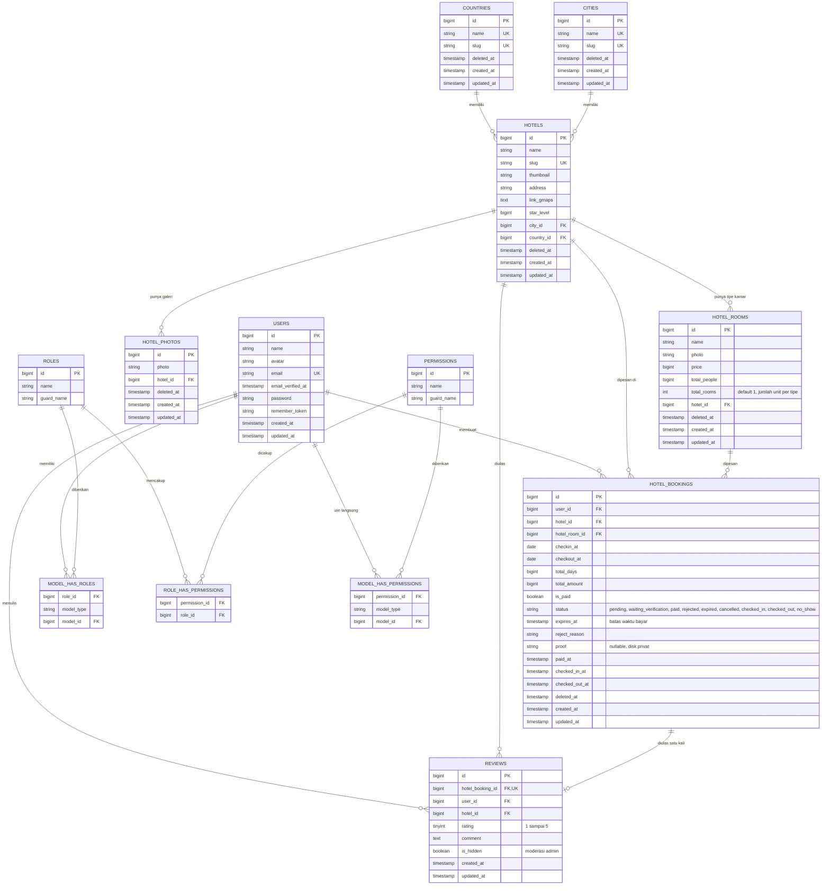
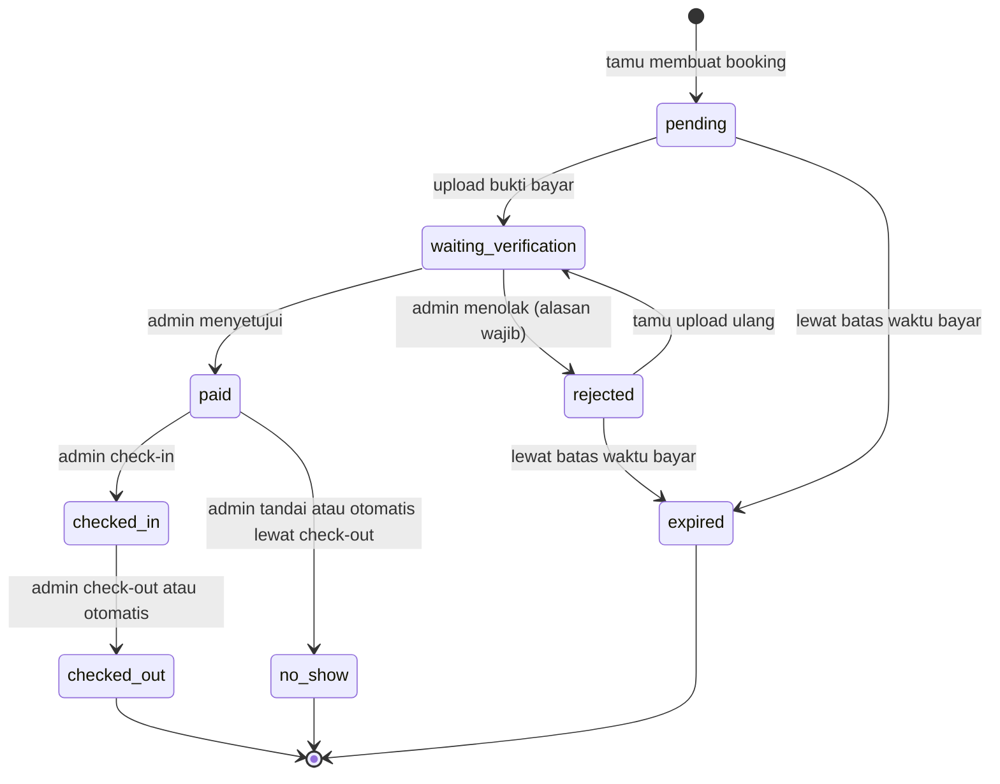

# ERD Hotel Luxury

Diagram ditulis dengan Mermaid, otomatis tampil di GitHub, GitLab, dan editor Markdown yang mendukung Mermaid.

## Catatan Desain

| Topik | Penjelasan |
|---|---|
| Soft delete | `countries`, `cities`, `hotels`, `hotel_photos`, `hotel_rooms`, dan `hotel_bookings` memakai `deleted_at`. Booking yang dihapus tamu hanya disembunyikan, review tetap tampil. |
| Ketersediaan kamar | Tidak ada tabel unit kamar. `hotel_rooms.total_rooms` adalah stok per tipe, dan sisa stok dihitung dari booking yang bentrok tanggal. |
| Booking bentrok | Dua rentang tanggal bentrok bila `checkin_lama < checkout_baru` dan `checkout_lama > checkin_baru`. Hari check-out tidak ikut dihitung. |
| Booking yang menahan stok | Status `paid`, `waiting_verification`, `checked_in`, serta `pending` dan `rejected` selama `expires_at` belum lewat. |
| Satu review per booking | Dijamin oleh unique index pada `reviews.hotel_booking_id`. |
| Index performa | `hb_room_status_dates_idx` (room, status, tanggal), `hb_user_created_idx`, `hb_status_expires_idx`, dan `reviews(hotel_id, is_hidden)`. |
| Tabel framework | `password_reset_tokens`, `sessions`, `cache`, `cache_locks`, `jobs`, `job_batches`, `failed_jobs` tidak digambar karena tidak berelasi dengan domain hotel. `sessions.user_id` hanya index, bukan foreign key. |
| Relasi `hotel_bookings.hotel_id` | Denormalisasi: sebenarnya bisa diturunkan dari `hotel_rooms.hotel_id`, tetapi disimpan agar query laporan dan dashboard lebih cepat. |

## Diagram Status Booking

